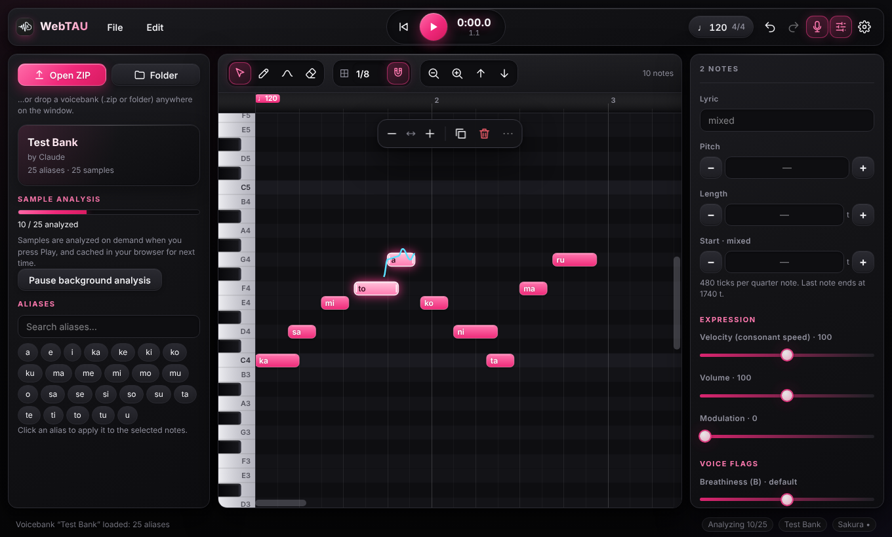
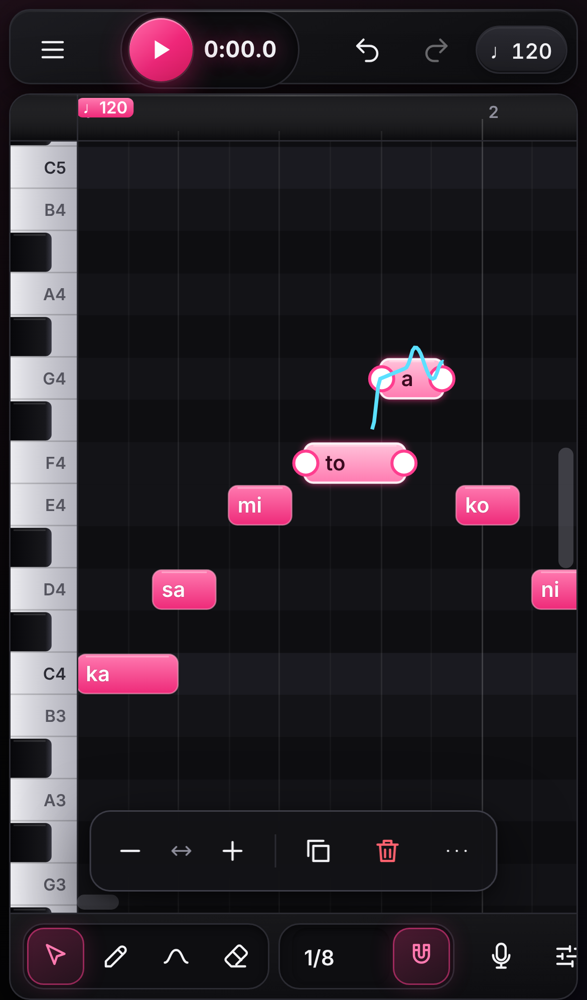

<div align="center">
  
  <h1>WebTAU</h1>

  <p>
    A browser-based vocal synthesizer for <b>UTAU voicebanks</b>.<br />
    Everything runs locally in your browser — Rust + WebAssembly engine, Svelte UI.
  </p>

  <p>
    <a href="https://charl1e7.github.io/webtau/"><strong>🌐 Open WebTAU</strong></a>
  </p>

  
  <br />
  
</div>

---

## ✨ Features

- **Voicebanks** — load a `.zip` or a folder (drag & drop works too). Shift-JIS / UTF-8 `oto.ini`,
  `prefix.map` (prefix + suffix), `character.txt` and portrait are understood. Missing `oto.ini` is generated.
- **Fast sample analysis** — samples are analyzed _lazily_ (only what your song uses), on a pool of
  workers, optionally in the background, and **cached in IndexedDB**: a voicebank is analyzed once per browser.
  Choose _Fast_ (DIO, default) or _Accurate_ (Harvest) quality in Settings.
- **Incremental rendering** — rendered notes are cached by the engine, so after an edit only the
  changed notes are re-synthesized.
- **Piano roll for desktop and touch** — select / draw / pitch / erase tools, drag to move, grab either
  edge to stretch (large handles on touch), rubber-band selection, copy / paste / duplicate, snapping
  (incl. triplets), zoom with wheel or pinch, long-press / right-click context menus, undo / redo.
- **Pitch** — two independent choices, both in Settings → Pitch and as a flyout (hold the pitch button, or
  right-click it). _Where_: **whole track** (default; one curve over all notes of the active track, each
  track in its own colour, baked into per-note points on UST export) or **single notes** (pitch stored on
  each note). _How_: **freehand** (default; drag with mouse or finger) or **points** (click to place, drag to
  move, double-click to remove). They mix freely: points of a freehand stroke can be grabbed, and a new
  stroke replaces what is under it. The drawn pitch moves with its notes when they are transposed or
  dragged. Also: shaped pitch points, auto-portamento, vibrato with fade-in/out, per-note flags,
  velocity, volume, modulation. The eraser removes notes and pitch by default; hold it (or right-click) to
  erase only notes or only pitch.
- **Import / export** — UST (import & export, pitch curves, vibrato, tempo changes), **USTX** (OpenUtau
  projects: tracks, notes, pitch points and shapes, vibrato, velocity / volume / gender / breath, the
  `pitd` pitch curve ⇄ the track pitch curve; written as USTX 0.6 so every OpenUtau can open it), MIDI (import with
  track picker & lyrics, export), project files (`.webtau.json`), WAV export.
- **Lyrics & plugins** — type `ra` for a kana voicebank (or `ら` for a romaji one), or `+` to continue the previous
  note, `R` for a rest, `ka[kya]` to force an alias; VCV banks get the right `a ら` alias from the previous
  note and `prefix.map` is honoured. Lyrics the voicebank cannot sing are marked right away, the suggestion list
  shows readings in both scripts, and importing a project opens _Fix lyrics_ with the nearest alias for each
  unknown syllable (one undo step). Edit ▸ Lyric tools converts between hiragana, katakana and romaji. All of it
  is built from small plugins you can switch off in Settings, see [docs/ARCHITECTURE.md](docs/ARCHITECTURE.md).
- **Tracks** — several tracks with mute / solo / volume / colour (all share the loaded voicebank), VSQX import,
  tempo map with markers you can drag on the ruler, time signatures, batch lyric filling (kana → morae).
- **Resampler flags** — `B` breathiness, `t` pitch offset, `g` gender (formant shift), `A` amplitude
  following pitch, `fe`/`fl`/`fv`/`fp` vocal fry; click a piano key to hear a preview of the note.
- **Installable & offline** — works as a PWA after the first visit; the UI adapts from phones to desktops.

## 🛠️ Development

Requirements: Node 22+, Rust (stable) with the `wasm32-unknown-emscripten` target and
[Emscripten](https://emscripten.org/) 4.x (`emsdk`) for the engine.

```bash
git clone --recursive https://github.com/charl1e7/webtau   # the WORLD vocoder is a git submodule
cd webtau
npm install

# build the engine (Rust -> WebAssembly) into src/lib/engine/wasm
source /path/to/emsdk/emsdk_env.sh
npm run build:wasm            # ./build.sh release

npm run dev                   # http://localhost:5173
```

| Command                                    | What it does                                  |
| ------------------------------------------ | --------------------------------------------- |
| `npm run dev` / `npm run build`            | Vite dev server / production build (`build/`) |
| `npm run lint` · `npm run check`           | Prettier + ESLint · svelte-check              |
| `npm test`                                 | Unit tests (core, UST, MIDI, project files)   |
| `npm run test:e2e`                         | Browser tests (Playwright) on desktop + phone |
| `cargo test -p w-synth --release`          | Unit tests of the Rust engine                 |
| `node scripts/bench-analysis.mjs <dir> 15` | Benchmark of the sample analyzer in Node      |

Set `BASE_PATH=/webtau` when building for GitHub Pages. Opening the app with `?debug` exposes the
state modules as `window.webtau` for debugging.

### Testing

- **Unit tests** (`npm test`, `cargo test`) cover the editor core, file formats and the engine.
- **Browser tests** (`npm run test:e2e`, in `tests/e2e`) drive the built app in Chromium with a
  _desktop_ and a _phone_ project (touch events, pinch, long-press). They build a small synthetic
  voicebank, and every test fails on uncaught exceptions or `console.error`. Besides feature flows
  they check things that are easy to break unnoticed: every dialog / menu / sheet can be closed,
  scrolling a list never "clicks" an item, controls have accessible names and big enough touch
  targets, nothing is clipped or scrolls sideways.
  Run `npm run build` first; set `PW_CHROMIUM_PATH` to use an existing Chromium.

### Architecture

```
crates/w-synth        Rust engine: oto/prefix parsing, WORLD analysis (chunked), note renderer,
                      stepwise synthesis sessions with a per-note render cache  → WebAssembly
src/lib/plugins       Extension API, lyric resolver, built-in plugins (see docs/ARCHITECTURE.md)
src/lib/render        Renderer backends (interface, registry, mixing, the WORLD backend)
src/lib/core          Pure editor logic: notes, tempo map, pitch curves, history, lyrics, ops
src/lib/io            UST, MIDI, project file, WAV, text decoding
src/lib/voicebank     Voicebank loading from zip / folders / drops (lazy sample access)
src/lib/engine        Workers, analysis scheduler, IndexedDB feature cache, engine session
src/lib/state         Svelte 5 rune state: project, view, playback, voicebank, settings, commands
src/lib/components    UI (canvas piano roll in components/roll)
```

### Engine benchmark

Analysis of a synthetic 15 s sample in Node, old engine vs. new (median of 3 runs):

| Engine                  | Time   | Cache size |
| ----------------------- | ------ | ---------- |
| before (Harvest)        | 13.3 s | 1.7 MB     |
| now, accurate (Harvest) | 9.5 s  | 0.84 MB    |
| now, fast (DIO)         | 4.5 s  | 0.84 MB    |

On top of that, the voicebank no longer has to be analyzed up front, and results are cached across sessions.

## 🗺️ Roadmap

- [x] Tempo markers editable right on the ruler (click, drag, double-click to add)
- [x] More resampler flags: gender `g`, amplitude `A`, vocal fry `fe`/`fl`/`fv`/`fp`
- [x] Multiple tracks (mute / solo / volume / colour) and VSQX (VOCALOID 3/4) import
- [x] Note preview when pressing the piano keys
- [x] Basic UST / MIDI import, pitch bend improvements, caching

## Feedback

Questions, ideas or bugs? Please [open an issue](https://github.com/charl1e7/webtau/issues/new).

## Credits

- **Straycat engine** — this project builds on [straycat-rs](https://github.com/UtaUtaUtau/straycat-rs).
- **Rust-WORLD** — [Rust-WORLD](https://github.com/BiggieBoo18/Rust-WORLD) bindings.
- **WORLD** — the [WORLD](https://github.com/mmorise/World) vocoder for speech analysis/synthesis.

## 📄 License

Distributed under the MIT License. See `LICENSE` for more information.
